# Benchmark

All numbers and plots on this page come from `eval/results/vm-3M/`, produced by
`eval/experiments.py` on the machine below. Each configuration ran 5 times. Dots/bars
are the mean, whiskers ±1 standard deviation.

## Testing Machine

| | |
|---|---|
| Machine | Linux virtual machine, Docker Compose |
| CPU | Intel Xeon Silver 4516Y+ (family 6, model 207, stepping 2) |
| CPUs | 4 (1 socket × 4 cores, 1 thread per core) |

The four vCPUs are equal, so four 1-CPU worker containers really run side by side
at the same speed. That is what these experiments assume.

> **Why not a Mac?** The same benchmark on a MacBook Air M2 gave unreliable numbers.
> The M2 has 4 fast and 4 slow (efficiency) cores, throttles when warm (it has no fan),
> and runs Docker inside a VM shared with everything else on the laptop. The same
> 3M-row job took anywhere from 7.5 s to 20 s there, vs. 6.2–6.5 s on this VM. For
> results that reflect 4 parallel workers, use a machine with at least 4 equal,
> otherwise idle CPUs (ideally 5+, so the boss and the script don't compete with the
> workers).

## Testing Task

- **Cluster:** one boss and 4 workers (`worker1`–`worker4`), each a Docker container
  limited to 1 CPU (`cpus: "1"`), sharing `./shared` as storage.
- **Data:** a generated, seeded dataset of **3,000,000 rows (≈110 MB)** in 4 CSV files,
  rows like `Madison,2026-03-14,4.2,ST00012345` (`city,date,temp,station`): 100 cities,
  nearly unique station ids. The combiner sweep uses separate 1M-row datasets with 10 to
  1,000,000 distinct keys.
- **Job:** average temperature per city (`examples/avg_temp.py`, 100 keys). The
  "unique keys" control uses average temperature per station
  (`examples/avg_temp_by_station.py`).
- **Tasks:** `num_maps = 16`, `num_reduces = 4` unless the experiment varies them.
  16 maps means each map task reads about 1/16 of the input (≈187,500 rows).
- **Timing:** job runtime as measured by the boss, from submission to the last reduce.
  Each experiment starts with an untimed warm-up job.
- **Correctness:** every run's output is compared with the experiment's first run (equal
  keys, values within 1e-9). All **175 runs matched**.
- **Command:**
  ```bash
  python3 eval/experiments.py --all --rows 3000000 --trials 5 --results eval/results/vm-3M
  SLOW_MS_PER_ROW=0.05 python3 eval/experiments.py --straggler --rows 3000000 --trials 5 \
    --results eval/results/vm-3M
  ```

## Results

### Baseline: one process vs. MapReduce
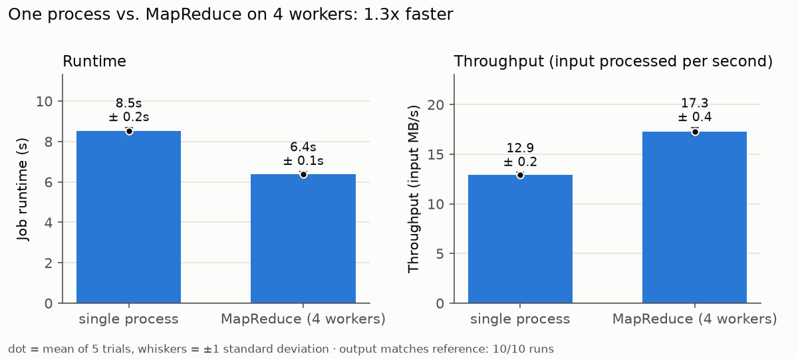

MapReduce on 4 workers takes **6.4 s** vs. **8.5 s** for plain single-process Python
(1.34× faster, 17.3 vs. 12.9 MB/s). The gain is far below 4×. MapReduce writes every
intermediate pair to disk as JSON, then reads, groups and sorts it again. That is roughly
twice the CPU work per row of a single in-memory loop.

### Combiner with repeated keys
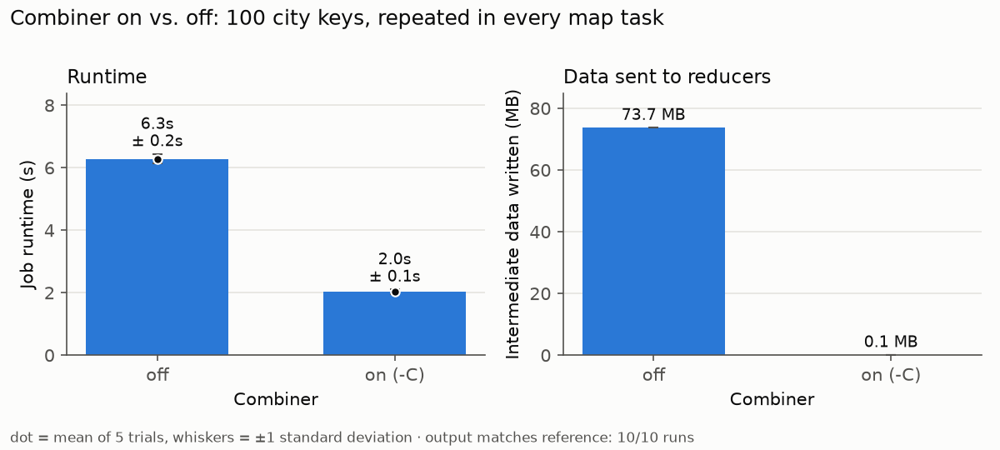

With only 100 city keys per map task, the combiner shrinks the data sent to reducers
from **73.7 MB to 66 KB**, and runtime drops from **6.3 s to 2.0 s** (3.1× faster).
Pre-aggregating on the map side removes most of the serialization and shuffle cost.

### Combiner with nearly unique keys (control)
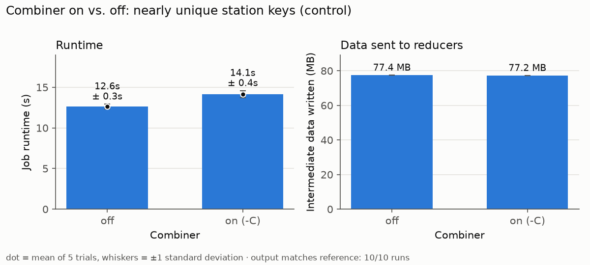

When almost every key is unique (station ids), the combiner has nothing to merge
(77.4 MB → 77.2 MB). It only adds work: **12.6 s → 14.2 s** (12% slower). A combiner
pays off only when keys repeat within a map task.

### Scaling with the number of workers
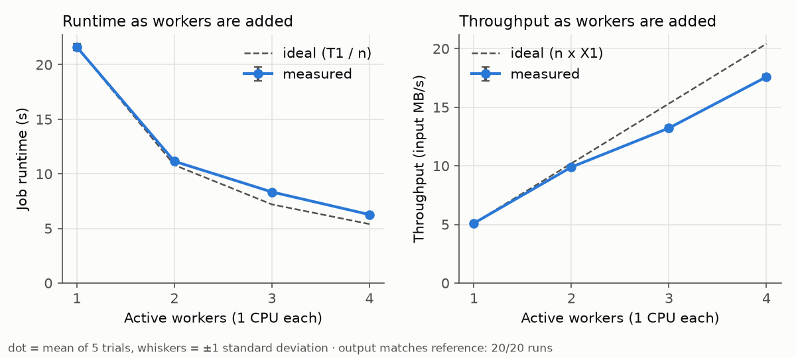

Runtime goes **21.6 → 11.1 → 8.3 → 6.3 s** for 1–4 workers: a 1.94×, 2.59× and 3.44×
speedup. Scaling is close to linear. The gap grows slowly because the reduce phase and
fixed costs (scheduling, phase barrier) don't shrink as workers are added.

### Worker killed during the map phase
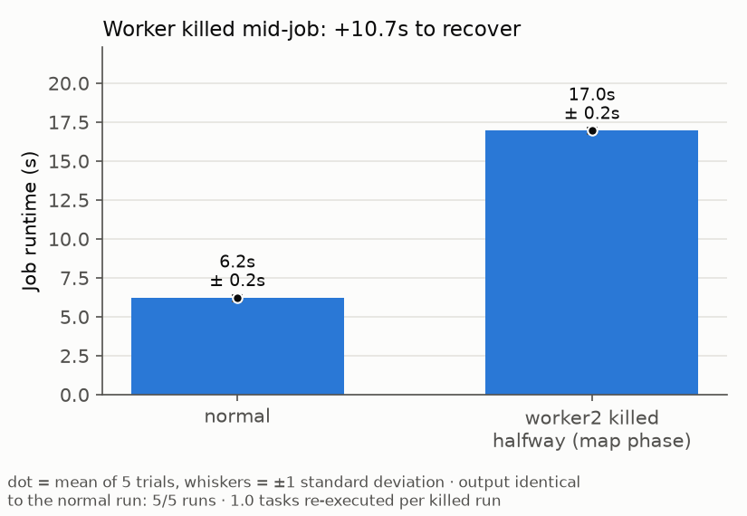

Killing worker2 halfway through the map phase raises runtime from **6.2 s to 17.0 s**.
The output is still byte-identical to the normal run. The extra ~10.7 s is the 10 s
heartbeat timeout before the boss declares the worker dead, plus re-running its one
lost task.

### Task granularity
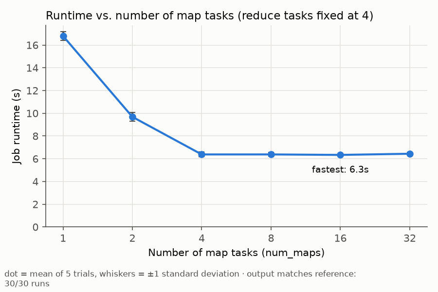

With 4 reduce tasks, going from 1 to 4 map tasks cuts runtime from **16.8 s to 6.4 s**,
because each map task occupies only one worker. Beyond 4 (one per worker) runtime stays
flat at ≈6.3–6.4 s, with 32 maps slightly slower from per-task overhead.
*(This run predates the reduce-task sweep. Rerun `--granularity` to add the second
panel, which varies `num_reduces` with 16 maps.)*

### Backup tasks with a slow worker
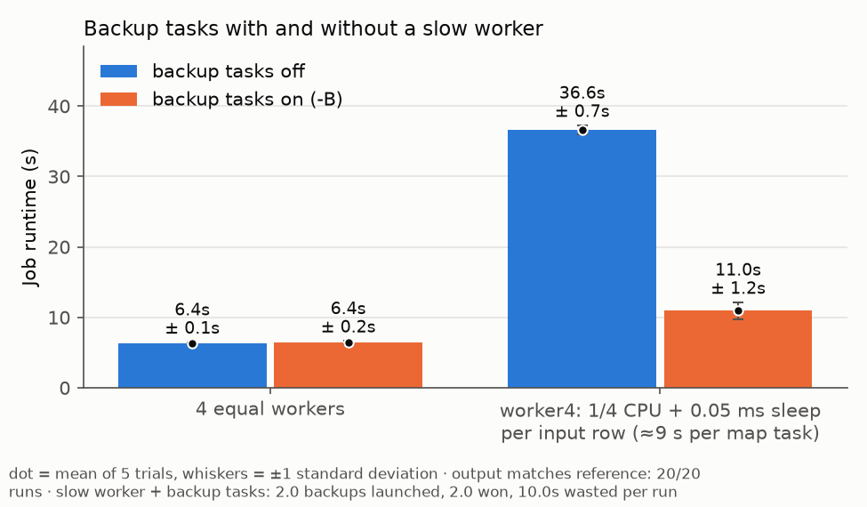

With 4 equal workers, backup tasks change nothing (6.4 s either way). With worker4
limited to 1/4 CPU plus a 0.05 ms sleep per input row (≈9 s extra per map task),
backups cut runtime from **36.6 s to 11.0 s** (3.3× faster). Every run launched 2
backups and both won, at a cost of ≈10 s of discarded work on the slow worker.

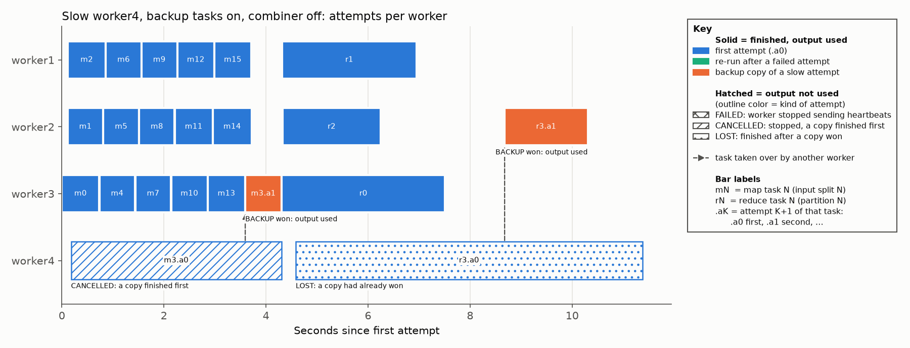

worker4's map `m3` was taken over by a backup on worker3 (`m3.a1`), and the slow
original was cancelled. worker4's reduce `r3` was likewise beaten by a backup on worker2.
Its own attempt finished later and was discarded (LOST).

### Combiner as keys become unique
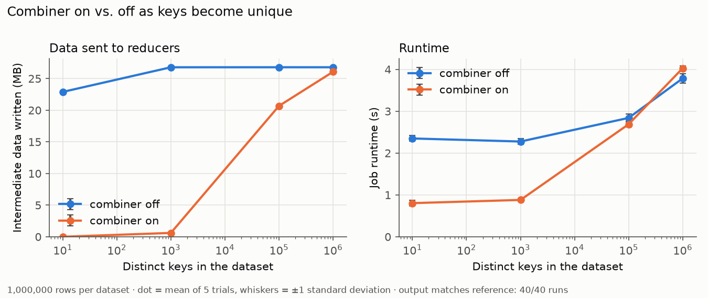

On 1M-row datasets, the combiner cuts runtime about 3× at 10 and 1,000 keys (e.g.
2.35 → 0.80 s), helps slightly at 100,000 keys, and is 7% slower at 1,000,000 keys
(3.78 → 4.03 s). Its benefit shrinks as keys repeat less often within a map task.

### Different kinds of worker failure
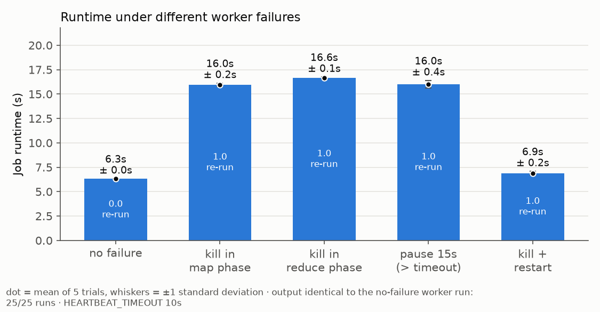

A worker killed in the map phase, killed in the reduce phase, or paused past the
timeout all cost ≈10 s (**16.0 / 16.6 / 16.0 s** vs. 6.3 s). That is the heartbeat
timeout plus one re-run task. A worker that is killed and immediately restarted costs
only 0.6 s (**6.9 s**): when it asks for new work, the boss immediately fails the
attempt it was running and re-queues the task. Every run produced output identical to
the no-failure run.

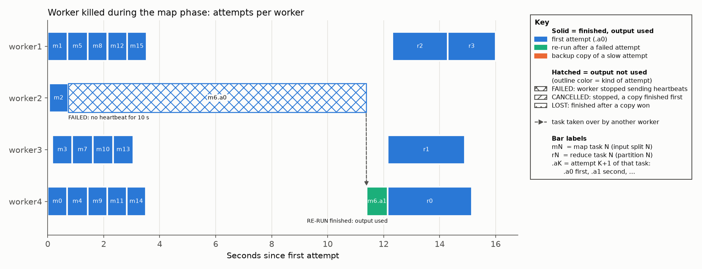

worker2 was killed while running map `m6`. Its attempt is marked FAILED once 10 s pass
with no heartbeat, and worker4 re-runs it (`m6.a1`) right away. The reduce phase starts
only after that, so the three remaining workers sit idle in the meantime.

## Customization Test

Run any subset of experiments by flag, or all of them. The cluster must be running
(`docker compose up -d --build`) and matplotlib installed on the host
(`pip install -r eval/requirements.txt`).

```bash
python3 eval/experiments.py --all                                  # all 9 experiments
python3 eval/experiments.py --baseline --scaling --trials 5        # just some
python3 eval/experiments.py --all --trials 1 --rows 300000 --sweep-rows 100000   # quick check
python3 eval/experiments.py --all --plot-only --results eval/results/vm-3M       # redraw only
```

| Flag | What it does |
|---|---|
| `--baseline` | single-process Python vs. MapReduce on 4 workers |
| `--combiner` | combiner off/on, 100 repeated city keys |
| `--combiner-unique` | combiner off/on, nearly unique station keys |
| `--scaling` | 1, 2, 3 and 4 active workers |
| `--fault` | normal run vs. worker2 killed halfway through the map phase |
| `--granularity` | `num_maps` 1–32 (4 reducers), then `num_reduces` 1–16 (16 maps) |
| `--straggler` | {4 equal workers, slow worker4} × {backup tasks off, on}, plus a Gantt chart |
| `--combiner-sweep` | combiner off/on on datasets with 10 to 1,000,000 distinct keys |
| `--failures` | no failure, kill in map, kill in reduce, pause > timeout, kill + restart, plus a Gantt chart |
| `--all` | all of the above |
| `--trials N` | runs per configuration (default 3) |
| `--rows N` | rows in the main dataset (default 3,000,000) |
| `--sweep-rows N` | rows per dataset in `--combiner-sweep` (default 1,000,000) |
| `--results DIR` | where CSVs and plots go (default `eval/results`) |
| `--plot-only` | redraw plots from existing CSVs without running anything |

Other settings:

- **Slower straggler:** `SLOW_MS_PER_ROW=0.05 python3 eval/experiments.py --straggler`
  adds a sleep per input row on worker4, on top of its 1/4 CPU limit. Put it on the
  same line or `export` it. A plain shell variable is not passed on.
- **Boss address:** `BOSS_URL` (default `http://localhost:5050`).
- **Default task counts:** `M, R = 16, 4` at the top of `eval/experiments.py`.
- **Results:** each experiment overwrites only its own `<name>.csv` / `.png` in
  `--results`. Use a new folder to keep earlier runs. The Gantt charts read
  `shared/jobs/<job_id>/events.jsonl` from the machine that ran the jobs.
- **After changing `mapreduce/`:** rebuild the images (`docker compose build`). The
  containers run the code copied in at build time.
